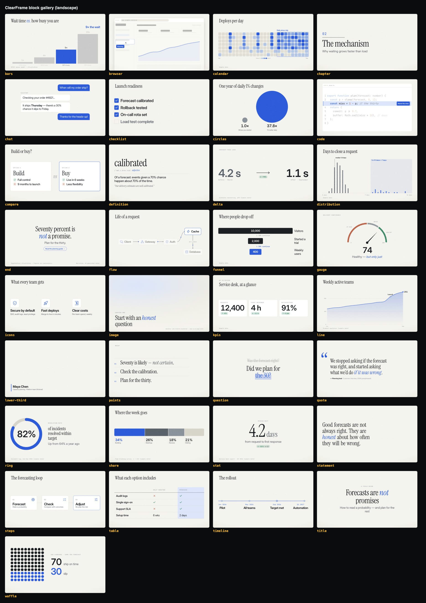

# ClearFrame

**Start here:** [`docs/guide.html`](docs/guide.html) is the guide to how ClearFrame works and how to prompt it for great films. Open it in a browser.

Agent-directed motion graphics rendered natively by the **ClearFrame scene engine** (Skia on the GPU; `docs/scene-engine.md`), with [fframes](https://github.com/dmtrKovalenko/fframes) as the film runtime that schedules, encodes and assembles the frames (`docs/fframes-return.md`). A film is one `storyboard.json`, recorded speech and optional media. The engine draws every frame itself from a compiled scene plan. It draws native GPU stages (actors, packets, commit-grounded code, footage, materials, particles, camera and motion blur) and the blocks' type, numbers, charts, diagrams and captions. Google models supply speech, music, images and the occasional footage insert.



## What it makes

- **Films, not slides.** The picture changes with the voice. A subject stays on screen across cuts (a `cast` of the film's objects, one drawn `world` the camera travels, a stage); `marks` point at the exact words of a form, policy or screen; the camera pushes to the detail on the word that names it. `critique` scores every storyboard against the eight tells of a slideshow, and `draft` measures how long the encoded picture sits still under the voice.
- **Captions to a broadcast standard**, on by default: two lines at most, broken where a reader pauses, timed to the measured words, white on a translucent box, moved to the top when the picture has type of its own at the bottom; the same cues go to SRT and VTT.
- **Drawn mechanisms.** Every scene can:
  - draw its own art (`canvas`: paths that draw on, markers travelling along routes, morphs across cuts, meters, hand-drawn pencil strokes, `marks` on the words they point at, a `document` of real text, a `pointer` that presses controls by id);
  - sit on imagery (full or split `plate` with duotone and tint treatments);
  - flood the frame with colour (`tone`) at a turn, and push in with a `camera` that moves for a reason;
  - cut, fade, or carry one movement across the cut with `push`, `wipe` or `panel`.

  Films take an editorial `frame`, grain and a vignette. See [canvas.md](docs/canvas.md) and [ideas.md](docs/ideas.md).
- **31 native blocks** for evidence and structure: hero type, counters, KPI cards, deltas, bars, lines, waffles, rings, donuts, funnels, area-true magnitudes, steps, timelines, flows, cycles, checklists, annotated screenshots, kinetic type (including poster `stack` type that builds as spoken). `clearframe blocks NAME` prints props and an example.
- **A creative library** ([library/](packages/engine/src/library/README.md)): palettes, treatments, sketches, playbooks and optional direction profiles, one file per item, validated on load. A project's own `library/` or a shared brand kit (`--library DIR`) adds or overrides them.
  - `treatments`: art directions such as workplace, business, editorial, sketchbook, blueprint and explanation. Everything in the library meets [the bar](packages/engine/src/library/README.md#the-bar): one job, reads on a phone, restrained motion, real content, a professional register.
  - `sketch`: canvas starting compositions for mechanisms (route, pipeline, balance…) and for workplace facts (`match`, `vesting`, `deadline`, `limit`, `expire`, `portal`, `inspect`, `choose`, `split`).
  - `canvas.props.teaching`: readable question, answer and explanation phases for multiple choice and fill-in-the-blank films. [Teaching sequences](docs/teaching-sequences.md).
  - `reference VIDEO`: the cut rhythm, keyframes, palette and motion of a film to borrow from.
  - `critique`: flags deck-like runs, stillness, text density, weak hooks and "and then" story chains.
  - `directions research|podcast`: optional story, picture and pace combinations. `--direction ID` seeds a project; explicit playbook/treatment/theme choices override it. Custom JSON profiles and fully authored canvas scenes keep the space open.
  - `playbooks`: starting arcs, including `benefit-explainer`, `policy-change` and `journey` (one drawing, a travelling camera).
- **From material to film:**
  - `ingest --markdown` turns a research report (or HTML/DOCX/PDF) into an evidence brief of figures, sources, tensions and chart-ready tables.
  - `ingest --audio` turns a podcast or talk into gapless beats with measured word timings, speakers and live meters.
  - The `clearframe-direction` skill walks from brief to story to look to pictures to review.
- **Type:** Inter, Inter Display and tabular figures; Instrument Serif for the italic accent word; IBM Plex Mono for labels and code; Architects Daughter for hand lettering. All are measured with the same shaper that draws them. Palettes (`clearframe themes`) are contrast-checked on load and in every tone.
- **Voice that performs:** Gemini 3.8 TTS reads the whole narration as one continuous take with one short style, so the voice stays consistent. Energy is written into the words. Also two-voice conversations, and word timings measured for free with local Whisper (`align --whisper`). Quiet sound cues (`sfx`) land on counters and chapter turns; an element's own `sound` plays where it is authored.
- **Honest numbers:** every figure needs a visible source; counters land on the exact value; `check` refuses what would mislead. See [speech timing](docs/speech.md) and the integrity skill.

## Start

Requires Node 22.19+ (23.x requires 23.4+), Rust 1.88+ and FFmpeg/ffprobe with libx264. Run `pnpm install --frozen-lockfile` and `pnpm build` for the checked TypeScript runtime, pinned OpenCode and Effect dependencies, and follow [native setup](packages/engine/src/film/SETUP.md) before the first build. The native renderer needs no browser.

The [local agent harness](docs/agent-harness.md) is available through `clearframe/harness`. The studio uses the same SQLite-backed job queue: durable request keys, lifecycle events, cancellation and explicit interrupted history. Effect scopes can own its lifetime. This is a standalone execution boundary for future director adapters; hosted rendering remains a separate qualification.

```sh
pnpm install --frozen-lockfile
pnpm build
pnpm cf doctor
pnpm cf new my-film --playbook data-story --treatment editorial
pnpm cf critique my-film              # rhythm, density, hook and story links, instantly
pnpm cf draft my-film                 # draft voice + check + sheet + draft MP4 in one pass
# Replace the illustrative claims in my-film/storyboard.json, then:
pnpm cf sheet my-film --draft      # contact sheet
pnpm cf voice my-film --draft      # free local narration
pnpm cf check my-film --draft      # validation + native diagnostics
pnpm cf render my-film --draft     # fast review MP4
pnpm cf render my-film             # final encode
```

Open the contact sheet, then watch and listen to the MP4. `build/video.mp4.json` records input hashes, the renderer's source hash, encoder, audio provenance, output hash and color space. Drafts keep authored layout and frame rate, allow provisional voice timing, and use a fast encoder. Optional `--scale 0.5` writes a smaller review copy; final output stays at authored resolution.

## From an idea, document and brand

`start` gathers the material into one portable project with an evidence brief, brand rules, copied assets and hashes. It prepares an illustrative arc for the directing agent to rewrite; no API calls are made.

```sh
pnpm cf start my-film --idea 'Explain cash timing' --document report.md --brand brand.json --playbook cash-flow
pnpm cf critique my-film
pnpm cf pipeline my-film --draft --scale 0.5
```

Research and podcasts can start from an evidence investigation, a mechanism, field notes, a visual essay, kinetic type or a drawn explanation. [Source adaptation and creative freedom](docs/source-playbooks.md) · [Custom directions](packages/engine/src/library/README.md#directions). The agent still authors the film from the actual source.

Financial arcs: `cash-flow`, `scenario-lab` and `client-update`, with native animated mechanisms. [Intake and brand kit](docs/intake.md) · [Financial playbooks](docs/financial-playbooks.md) · [Free example](examples/financial-intake/README.md). The focus is a mature standalone production pipeline, exercised through its CLI before any host integration. [Production method and harness](docs/production.md) · [Measured pipeline efficiencies](docs/performance.md).

## From a document or recording

```sh
pnpm cf ingest digest --markdown report.md        # BRIEF.md: figures, sources, tensions, tables
pnpm cf ingest clip --audio episode.wav --words words.json --script script.txt --from 312 --to 358 --vertical
pnpm cf reference inspiration.mp4                 # REFERENCE.md + keyframe sheet
pnpm cf align clip --whisper                      # free, local, measured word timings
pnpm cf paper clip                                # the paper edit: chapters, timecodes, transcript
pnpm cf draft clip --rough                        # full-length rough cut; placeholders as slates
```

## Review and edit

Every render saves a revision in `DIR/review/`, with its inputs kept by content, and `review/index.html` plays it beside the transcript with a note box stamped with the revision and playhead. Notes stay anchored to the cut that was watched; an edit becomes a candidate with a before/after preview of just the affected stretch; acceptance is recorded only from the person. Recorded narration is cut, split and restored from the source recording with measured timing intact. See `docs/editing.md`.

```sh
pnpm cf note clip "the diagram is confusing; keep the voice" --at 2:13 --rev r003 --keep voice --by Ana
pnpm cf revise clip --note n001                   # candidate + before/after passages + impact report
pnpm cf accept clip r004 --note n001 --by Ana --said "yes, clearer"
pnpm cf cut clip --words "which is a story for another day" --by Ana   # undo: uncut clip --cut c001
pnpm cf runlog clip                               # measured time per command and phase
```

Then follow `skills/clearframe-direction/SKILL.md`: find the question and the turn, pick a treatment, plan a picture per beat, critique, and have a fresh reviewer read the sheet.

## Authoring and review

`storyboard.json` is the single source for scenes, data, palette, motion and cues; the [engine skill](skills/clearframe-engine/SKILL.md) describes the contract and [the style guide](docs/style.md) the design system. Canvases are landscape, vertical, square and portrait at 24/25/30/50/60 fps.

Cue anything to speech: `land`, `growSay`, `drawSay` and per-item `say` take an exact spoken word or phrase. `check` refuses what would mislead or break a film instead of rendering it quietly wrong:

- numbers without a visible source and a `sources` entry, negative bars or scales that do not cover the data;
- beats that end before their counters and bars reach the true values;
- items cued too late to finish entering, text that overflows its box at 14 px;
- speech-following text on estimated timing, or characters the bundled fonts cannot draw.

`looks DIR --beat ID` renders one frame in every palette. `still --beat ID` inspects a moment; `review DIR` decodes the encoded MP4 around every cut and word boundary. `qa DIR` reads the whole film for time bugs: one-frame pops, stretches where the picture barely changes (measured as change per second against the frame a second earlier), world seams that jump, export tags and loudness; it writes a one-frame-per-second timeline and a 360 px phone sheet. `beatmap DIR` measures the music's tempo and drop, and `music.drop` lands that drop on a beat. Paid commands are explicit: `plan` estimates spend, then `voice`, `music`, `images`, `clips` or `align --transcribe` call Google. Existing recordings and imported timestamps need no API key.

## Development

```sh
pnpm test                                                             # full suite
pnpm cf build                                            # native renderer (warm cache)
pnpm cf gallery build/gallery-paper --theme paper
pnpm cf gallery build/gallery-ink --vertical --theme ink
node scripts/verify-native.mjs build/native-verification-new
```

The workspace uses pnpm, Turbo, strict TypeScript and Effect. `packages/engine/src/engine/` owns orchestration, the SQLite harness, provider boundaries, timing, audio and the browser studio; `packages/engine/src/film/` owns authoring contracts, schemas, native jobs and finishing; `packages/engine/src/scene/` owns scene compilation and the Rust renderer. `apps/cli` packages a self-contained runtime and exports `clearframe/harness`. Shared compiler configuration, lint rules and build/schema tools live under `tools/`.

Run `pnpm guardrails` for lint, type checks, Effect diagnostics, the distributable build and contract tests. `pnpm test:lint` exercises the local lint rules. `pnpm catalog:sync` regenerates the authoring JSON schema, block reference and recipes after a build. Runtime JavaScript, declarations and the bundled browser app are generated into `dist/`; source is never overwritten by a build. The native cache lives at `~/.cache/clearframe/scene` (override with `CLEARFRAME_SCENE_CACHE`), outside replaceable distributions. Native compilation uses one Cargo job and at most two workers. Serialize expensive work on memory-constrained machines.

Run `pnpm test:package` after building to install the packed CLI in a fresh directory, repeat installation with its frozen lockfile, and execute the public harness. CI runs this check separately so workspace overrides cannot hide a broken consumer dependency graph.

Sound cues and measured voice rates also live under `~/.cache/clearframe`; `CLEARFRAME_CACHE` changes the common cache root, while `CF_SFX_CACHE` and `CF_VOICE_RATES` retain their individual overrides. Library-bar evidence defaults to the current working directory's `build/library-bar/`, so rebuilding or replacing an installation preserves it.

Render receipts identify the code that actually ran. The TypeScript migration changes that fingerprint: retain earlier receipts as historical evidence and render again to validate the current compiled runtime. Run production commands from the built CLI so receipts use the same executable code identity.

Fonts are static instances derived from the pinned OFL Inter source (`packages/engine/src/scene/native/tools/generate-fonts.py`); icons are 132 MIT Tabler outlines at a pinned revision (`fetch-icons.py`, `generate-icons.py`). The retired HTML/GSAP engine is preserved in [archive/](archive/README.md) for recovery only.

[Changelog](CHANGELOG.md) · [Verification evidence](docs/verification.md) · [GitHub research and reuse policy](docs/research/2026-github-video-patterns.md) · [Migration history](docs/fframes-migration.md)
